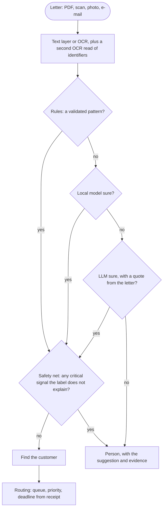

# doc-router

Incoming letters have to be classified, matched to a customer and routed to the right team before a statutory deadline runs out (7 days for a seizure, 30 for a complaint). This proof of concept handles Polish-language letters in an insurance setting (bailiffs, courts, customers, regulators and suppliers, hundreds a day) and checks whether this can be automated safely and what it costs.

It is not production software:

- All numbers come from a synthetic corpus (about 5000 letters written by LLMs, plus 128 rendered scans). That is enough to compare designs, not to promise accuracy on real mail.
- Core systems are a JSON fixture, and the operator console has no login.
- The next step would be 1500-3000 real, anonymised letters, a blind test set and a few weeks of shadow mode next to today's process.

## Run it

```
pnpm install
pnpm start                 # http://127.0.0.1:3000, operator console + API
pnpm classify samples/02-wypowiedzenie-z-reklamacja.txt
pnpm classify samples/08-odreczne-wypowiedzenie.jpg
pnpm eval --llm-baseline   # 1511 test letters, cascade vs LLM only
pnpm check                 # typecheck, lint, format, tests
```

Without `OPENAI_API_KEY` it still runs: letters the local model is unsure about go to a person instead of the LLM.

## Results

1511 test letters from scenarios not used in training, 866 of them in critical classes, with `gpt-5.4-mini` as the LLM:

| Design                     | Accuracy | Auto-routed | Precision of auto-routed | Critical lost | Wrong customer | LLM cost / 1000 letters |
| -------------------------- | -------- | ----------- | ------------------------ | ------------- | -------------- | ----------------------- |
| Cascade (local model, LLM) | 97.9%    | 67.2%       | 98.1%                    | 12 / 866      | 0              | $0.35                   |
| LLM on every letter        | 97.9%    | 73.6%       | 97.8%                    | 17 / 866      | 0              | $1.79                   |

Same accuracy, fewer lost critical letters, a fifth of the cost, and only 20% of letters sent to an external model. The price is more manual review: 328 against 264 letters per 1000. On the 128 scans and handwritten letters, read from pixels, accuracy is 98.4% with no letter attached to the wrong customer.

## How it works



- **Rules** are a few regexes (bailiff and court case numbers). A rule may decide alone only if it is at least 95% precise on training data. On this corpus none qualified, so they work as hints and as the safety net.
- **Local model**: TF-IDF with logistic regression. Each class has a threshold calibrated on scenarios the model has not seen. It never decides `OTHER`, and it does not decide when a critical class is a close second.
- **LLM**: only for the uncertain 20%. It must quote the letter verbatim, and the quote is checked. Low confidence, a conflict with the local model, or moving a letter from a critical class to an ordinary one all send the letter to a person.
- **Safety net and injection check** run on every letter. A critical keyword the label does not explain, or text that tries to instruct a model, forces review.
- Any failure (OCR down, LLM down, corrupt file) ends in a review queue, never in a lost letter.

Example, `samples/02`: a customer terminates a policy and, in passing, complains about a 40% premium increase. Rules find nothing. The local model leans towards a complaint but stays below its threshold. The LLM decides `COMPLAINT` with a quote. The customer is confirmed by name and policy number, and the letter lands in `complaints` at P1 with a 30-day deadline and an alert about another open complaint. A keyword router would have filed it as a termination.

## Customer matching

Policy, claim and complaint numbers have no check digit and are issued in sequence. One misread digit often gives a real number that belongs to someone else.

- PESEL, NIP, REGON and IBAN are validated by checksum.
- Letters read in place of digits ("O" for "0") are repaired and flagged.
- Besides exact lookups, numbers one OCR confusion away are looked up too.
- A match is attached automatically only if something independent confirms it: a second identifier, or a name in the letter that fits only this candidate. Otherwise a person picks from the candidates, each shown with its evidence.

On 2000 generated letters where every policy has a neighbour one OCR slip away, exact matching attached 800 letters to the wrong person. Hybrid matching attached none.

## OCR and handwriting

A vision model transcribes the scan and marks unreadable parts instead of guessing. A second, different model reads only the identifiers. An identifier the two reads disagree on, or one from handwriting read only once, is shown to the reviewer but not used for matching. Low-quality text goes to the critical review queue, because an unread letter may carry a 7-day deadline.

Known issue: the handwriting flag also fires on typed letters with a handwritten signature (44 of 52). The only effect is stricter handling.

## Other findings

- **Local model choice.** A multilingual BERT-type encoder (e5-small, frozen) lost to TF-IDF at every training size, from 240 to 3644 letters, and doubled LLM traffic in the cascade. With real letters, a fine-tuned HerBERT is worth testing behind the same interface.
- **Corpus.** Letters were generated from scenario briefs. A quarter of the scenarios of each class are held out for testing, and identifiers are generated by code with valid checksums against a 400-customer CRM. The test set also includes 40 prompt injections, 40 OCR-noise letters and 40 slipped policy numbers.
- **Caveats.** The test set was used to find which categories failed (the fixes were designed on training data), so it is no longer fully blind. Three classes were written by a different LLM than the rest. Accuracy per author is in the report.
- **Remaining errors.** Most of the 12 lost critical letters are complaints hidden inside terminations. A proper fix is multi-label output: one task per intent, each with its own deadline.

## Towards production

| PoC              | Production                                                                |
| ---------------- | ------------------------------------------------------------------------- |
| Vision-LLM OCR   | Azure Document Intelligence in an EU region, the LLM as a second read     |
| TF-IDF           | Fine-tuned HerBERT once there is real data, chosen by `pnpm eval`         |
| OpenAI API       | EU data zone with zero retention, or a self-hosted model (Bielik)         |
| JSON fixture     | Read-only adapters to CRM, policy, claims, complaints and legal systems   |
| Synthetic corpus | Real labelled letters, shadow mode, automation switched on class by class |
| Not done         | Login, splitting multi-letter PDFs, multi-label letters, drift monitoring |

## Code

TypeScript in strict mode, Zod at every boundary (config, HTTP, LLM and OCR output, data files), Hono API, SQLite store. LLM calls go through one cached interface, so evaluations are reproducible.

```
src/
  ingest/       PDF text, OCR (first and second read)
  pipeline/     rules, safety net, cascade
  classifier/   TF-IDF and embeddings models, calibration
  llm/          LLM client and classifier prompt
  extraction/   identifiers, checksums, OCR repairs
  enrichment/   core systems fixture, customer matching
  routing/      queues, priorities, deadlines
  store/        SQLite
  api/          HTTP API and operator console
  evaluation/   metrics and cost model
  cli/          classify, train, eval
scripts/        corpus and scan generation
data/           corpus, CRM fixture, scans
reports/        latest evaluation reports
```

Configuration: `.env.example`. Full evaluation results: `reports/latest-eval.md` and `reports/latest-scans.md`.
