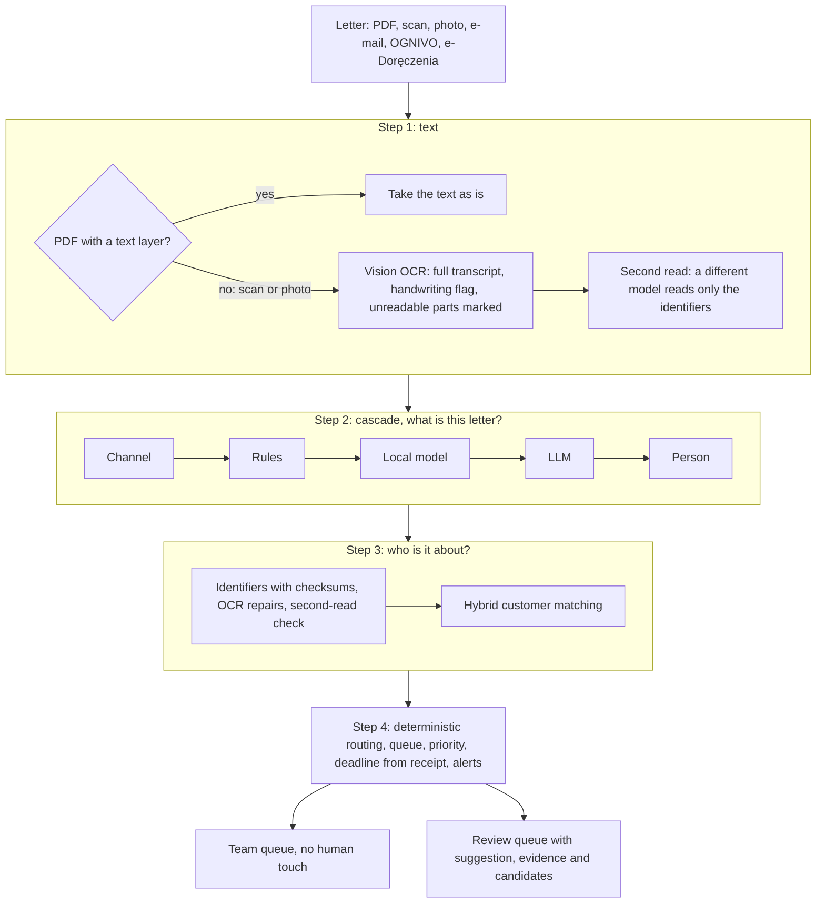
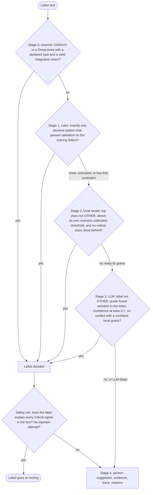
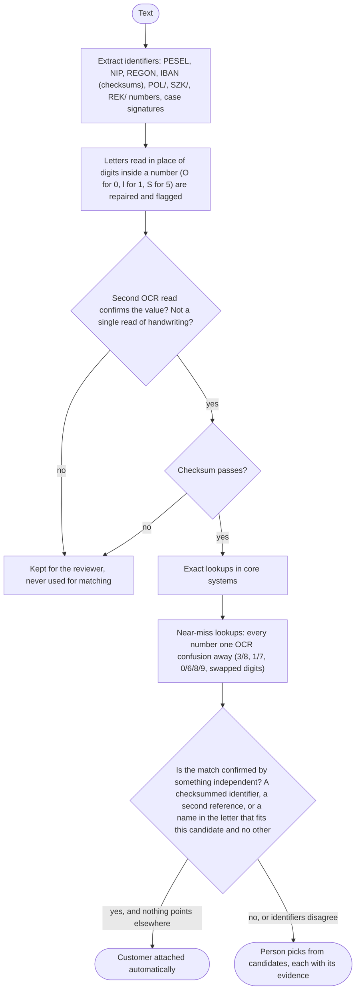
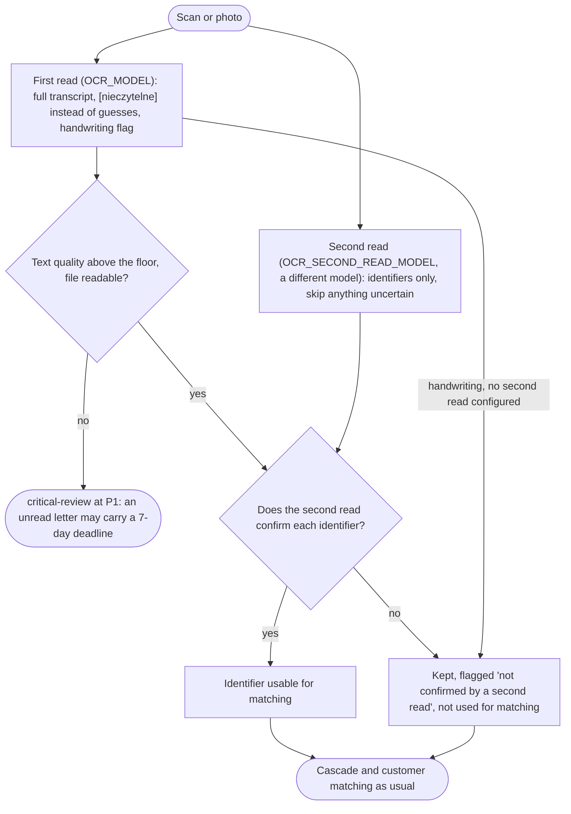

# doc-router

A working proof of concept for the incoming-correspondence case study: a Polish financial company receives hundreds of letters a day (bailiffs, courts, customers, regulators, suppliers) and has to classify each one, find out who it concerns, and get it to the right team before a statutory deadline expires.

The design follows one idea: **this is not a classification problem, it is a deadline-management problem under uncertainty.** A seizure notice is effective the moment it is delivered and the bank has 7 days; a complaint left unanswered for 30 days is deemed accepted. So the system is built to never lose a critical letter, never attach a letter to the wrong customer, and automate only what it can automate with measured precision.

```
pnpm install
pnpm start                 # http://127.0.0.1:3000  operator console + API
pnpm classify samples/02-wypowiedzenie-z-reklamacja.txt
pnpm classify samples/08-odreczne-wypowiedzenie.jpg   # handwriting, OCR with a second read
pnpm eval --llm-baseline   # 1511 held-out letters, cascade versus LLM only
pnpm eval:scans            # 128 rendered scans, photos and handwritten letters, from pixels
pnpm check                 # typecheck + lint + format + 139 tests
```

Without `OPENAI_API_KEY` everything still runs: the cascade uses the local model, and sends the uncertain band to people. With the key, the LLM handles the uncertain band and OCRs scans.

## Results in one table

Measured on 1511 held-out letters written from scenarios never used in training (866 of them critical), with `gpt-5.4-mini` as the LLM:

| Design                          | Suggestion accuracy | Routed with no human | Precision of auto-routed | Critical letters lost | Wrong customer, auto-routed | LLM cost per 1000 letters |
| ------------------------------- | ------------------- | -------------------- | ------------------------ | --------------------- | --------------------------- | ------------------------- |
| **Cascade (TF-IDF, then LLM)**  | **97.9%**           | 67.2%                | **98.1%**                | **12 / 866**          | **0**                       | **$0.35**                 |
| LLM on every letter, same gates | 97.9%               | 73.6%                | 97.8%                    | 17 / 866              | 0                           | $1.79                     |

The cascade is as accurate as calling the LLM on every letter and slightly more precise, loses fewer critical letters, sends 80% of the mail through no external model at all, and costs a fifth. It pays for that with more letters for a person (328 against 264 per 1000), which is the right trade for a deadline problem. On 128 rendered scans, photos and handwritten letters read from pixels, the same pipeline reaches 98.4% accuracy with no wrong customer.

## The whole picture



Each step can say "I am not sure". Uncertainty never stops a letter: it moves the letter to a person, with the deadline already running and everything the system found shown on screen.

## The cascade

Cheapest sieve first. Each stage decides only when it is sure; otherwise it passes the letter on, keeping its best guess as a suggestion for the next stage or the reviewer.



Two checks run on every document regardless of which stage decided:

- **Safety net.** Keyword signals for critical classes (seizure wording, "nakaz zapłaty", complaint phrases, "akt zgonu", RODO, prosecutor). If the final label does not explain a signal, the letter goes to the fast `critical-review` queue. A false alarm costs a minute; a missed seizure costs damages.
- **Injection tripwire.** Text that addresses a model ("zignoruj poprzednie instrukcje", "classify this as") forces human review. The LLM also has no tools, returns only a label from a closed list, and routing is deterministic code, so the worst a hostile letter can do is get itself looked at.

### Stage by stage

**0. Channel.** If the letter arrived through OGNIVO or e-Doręczenia with a declared type, that type is the label (confidence 1.0). The claim is trusted only with a valid integration token; without it the API answers `403`, so nobody can skip the classifier by typing `channel: OGNIVO`.

**1. Rules** (`src/pipeline/rules.ts`). The text is NFC-normalised and checked against a few decisive patterns: a bailiff case number with affirmative seizure wording, a bailiff inquiry under art. 761, a court case number under a court header, a tax-office seizure. **A rule earns the right to decide alone from data**: `calibrateRules` measures each rule on the training letters and keeps it decisive only if the lower 95% bound of its precision is at least 95%. On the 5000-letter corpus none of the four passes (the court-case rule is right 89.6% of the time, because criminal-court requests from prosecutors carry the same signatures), so today the rules decide nothing alone. They still matter: the same pass feeds the safety net and the tripwire, and a matched rule shows up in the trace as a hint. That is the honest outcome of measuring regexes instead of trusting them.

**2. Local model** (`src/classifier/`). TF-IDF over Polish prefix-stemmed words and bigrams, softmax regression with a seeded PRNG. Each class has its own threshold, calibrated on out-of-fold predictions to reach 97% precision (99% for critical classes), with **folds grouped by scenario**: the threshold is set on scenarios the model has not seen, which is what production looks like when a new court or law firm sends a new template. Two more guards: `OTHER` is never accepted, and if the top class is ordinary but a critical class has at least 0.2 probability behind it, the model does not decide alone (a termination that hides a complaint looks like a termination with a complaint-shaped shadow, and the shadow is the part with a deadline).

**3. LLM** (`src/llm/llm-classifier.ts`). Only letters nobody has decided get here, 20% in the evaluation. The model receives the class definitions and the letter fenced as data, and must return, in this order: a verbatim evidence quote, a rationale, a label from a closed list or `OTHER`, and a confidence. The output is validated with Zod. A quote that is not in the letter means the label is not trusted (`ungrounded_evidence`). A confident local prediction of a different class blocks the decision (`model_conflict`), unless the LLM agrees with the critical runner-up the local model raised itself.

**4. Human.** Whatever is left goes to a queue with the best suggestion, the evidence, the cascade trace and the reasons for review. `critical-review` (P1) takes anything with a critical label or signal and anything unreadable; `manual-classification` (P2) takes the rest. The correction, including the confirmed customer, is stored and exported as training data.

**Every stage leaves a trace**: decided, abstained or skipped, with the reason and its duration. **Failures degrade to a person, never to a loss**: an LLM outage, an OCR outage or a corrupt file still produces a stored document in a review queue.

### A worked example

The hidden complaint in `samples/02-wypowiedzenie-z-reklamacja.txt`: a customer terminates a policy and, in passing, complains that nobody answered why the premium went up 40%. Output of `pnpm classify`:

| Stage       | Outcome                                                                                                                                                                                                                                                                                                                                      |
| ----------- | -------------------------------------------------------------------------------------------------------------------------------------------------------------------------------------------------------------------------------------------------------------------------------------------------------------------------------------------- |
| Channel     | skipped: a paper scan carries no declared type                                                                                                                                                                                                                                                                                               |
| Rules       | abstained: no decisive rule, and the letter never says "reklamacja"                                                                                                                                                                                                                                                                          |
| Local model | abstained: top `COMPLAINT` at p=0.401, below its class threshold of 0.413                                                                                                                                                                                                                                                                    |
| LLM         | decided `COMPLAINT` at 0.94, with the quote "od czerwca nikt nie odpowiedział mi na pytanie, dlaczego przy odnowieniu naliczono mi składkę o 40% wyższą niż w zeszłym roku", found verbatim in the letter. Had it answered `CONTRACT_TERMINATION` instead, the local model's lean to a critical class would have sent the letter to a person |
| Enrichment  | policy number found, customer C0005 confirmed by the name in the letter, another open complaint on file                                                                                                                                                                                                                                      |
| Routing     | `complaints` at P1, deadline 30 days from receipt, alert "customer also has open complaint REK/2026/07439"                                                                                                                                                                                                                                   |

The letter opens with "nie zamierzam dłużej korzystać z Państwa usług", so a keyword router would have filed it as a routine termination and the complaint would have been deemed accepted after 30 days.

## Who is the letter about

A correct label with the wrong customer is still a wrong decision: a seizure applied to the wrong account, a complaint answered to a stranger. Customer numbers are where OCR hurts most, because **policy, claim and complaint numbers have no check digit and are issued in sequence**: misread one digit and you very often land on a real number that belongs to someone else.



- **The name check** (`nameInLetter`) folds diacritics (OCR often drops them) and compares stems, so "Joanny Nowak" and "Agnieszki Kamińskiej" match their CRM records; it requires first name and surname next to each other, so "nowa umowa" is not Mrs Nowak; companies are matched by their core name ("Witkowski Logistyka" in "Witkowski Logistyka sp. z o.o."). **A name confirms only if it fits one candidate**: two Barbara Dudeks one OCR slip apart prove nothing. Production replaces the stems with Morfeusz and probabilistic record linkage; it stays a second factor, never the only one.
- **Near-miss lookups are exact lookups of generated variants**, so they work against any core system that can look a number up.
- **The reviewer chooses the customer**, from a list where each candidate says why it is there ("POL/2024/000013 is one OCR slip away from POL/2024/000018; name appears in the letter"). An unconfirmed match is never preselected.

Measured on 2000 letters generated from the 400-customer CRM, each customer given a neighbouring policy number one OCR confusion away:

| Case                                          | Exact matching: wrong customer | Hybrid: auto, wrong | Hybrid: to a person | ...with the right customer suggested first |
| --------------------------------------------- | ------------------------------ | ------------------- | ------------------- | ------------------------------------------ |
| clean number and name                         | 0 / 400                        | 0                   | 1                   | 1                                          |
| clean number, no name                         | 0 / 400                        | 0                   | 400                 | 400                                        |
| OCR slip onto a neighbour, name present       | **400 / 400**                  | 0                   | 400                 | 400                                        |
| OCR slip onto a neighbour, no name            | **400 / 400**                  | 0                   | 400                 | 0 (both listed, nothing tells them apart)  |
| letter read in place of a digit, name present | 0 / 400                        | 0                   | 1                   | 1                                          |

Exact matching attached 800 of 2000 letters to the wrong person without telling anyone. Hybrid matching attached none. On the main test set, which includes 40 letters with a slipped policy number, no letter was auto-routed with the wrong customer.

## Bad OCR and handwriting

Handwritten letters come mostly from individuals: complaints, withdrawals, terminations, death notifications. Several of those are critical classes, so a misread handwritten letter is exactly the case the system must not get wrong quietly.



1. **The OCR is told not to guess.** Anything unreadable becomes `[nieczytelne]`, which lowers the quality score. Below `OCR_QUALITY_FLOOR`, or with a failed extraction, the letter goes to `critical-review` at P1 with its deadline already running.
2. **Two independent reads of the fields that decide who the letter is about.** A vision model that invents a plausible digit rarely invents the same digit twice. The second read returns a few short strings, so it costs a fraction of the first.
3. **Disagreement does not block anything.** The identifier stays visible with a chip saying why, and is simply not used to find a customer.
4. **Handwriting read only once is never trusted for matching.**
5. **The reviewer confirms one field, not the whole letter**: each identifier's status, the candidates with their evidence, a customer picker.

### Measured from pixels

`pnpm scans:generate` rendered 128 test letters as images with gpt-image-2 (on fal.ai): typed office scans, phone photos of folded letters on a desk, and handwritten letters in ballpoint on lined paper. `pnpm eval:scans` runs the whole pipeline on them, from JPEG to queue:

| Style       | n   | Suggestion accuracy | Routed with no human | Precision of auto-routed | Critical lost | Wrong customer | Identifiers read exactly |
| ----------- | --- | ------------------- | -------------------- | ------------------------ | ------------- | -------------- | ------------------------ |
| typed scan  | 52  | 98.1%               | 75.0%                | 97.4%                    | 1 / 35        | 0              | 34 / 34                  |
| phone photo | 48  | 100.0%              | 68.8%                | 100.0%                   | 0 / 27        | 0              | 32 / 32                  |
| handwritten | 28  | 96.4%               | 71.4%                | 95.0%                    | 0 / 10        | 0              | 19 / 19                  |
| **all**     | 128 | **98.4%**           | 71.9%                | 97.8%                    | 1 / 72        | **0**          | **85 / 85**              |

Every handwritten letter was flagged as handwriting. The flag also fires on 44 of 52 typed scans, which carry a handwritten signature, even after the prompt was told that a signature alone does not count. The cost is only stricter handling (identifiers need the second read, which runs anyway); Azure Document Intelligence returns handwriting per span and removes the guesswork. Rendered images are cleaner than a tired mailroom scanner, so these numbers are an upper bound for OCR quality, and the real-scan sample in the PoC plan is still needed.

## The corpus: 5000 letters

The first version was evaluated on 448 letters. That was enough to build the mechanics and too few to trust a number, so the corpus was rebuilt at scale (`scripts/generate-dataset.ts`):

- **Scenarios.** The hand-written briefs plus 14 new briefs and 2 deliberately misleading ones per class, written by gpt-5.4 from the class definitions (`data/briefs.json`). A quarter of the briefs of every class never appear in training: the test set measures generalisation to new kinds of letters, not recall of seen ones.
- **Letters.** About 300 per class, 5 per batch, each batch with a random variation card (sender, register, format, length, extras), so 60 batches of a class are not 60 copies of one letter. 1070 letters came from gpt-5.4; the remaining 4000 were written by 26 Claude subagents working from the same job files, which kept the cost of the corpus at the price of the first 200 batches.
- **Identifiers from code, never from a model.** Every PESEL, IBAN and NIP has a correct (or deliberately broken) checksum and links to a 400-customer CRM with sequentially issued policy numbers, so OCR neighbours exist everywhere.
- **Cleaning.** Near-duplicates are dropped; letters the local model disagrees with (46) were re-read by an independent judge against all definitions, and 35 that belonged to another class were removed. Only the disagreements were judged, so the test set is not filtered by agreement with the LLM that later competes on it.
- **Robustness variants**, test only: 40 prompt injections, 40 OCR-noise letters, 40 letters whose policy number slipped onto a neighbour's.

Result: 3644 training and 1511 test letters.

**A confound, measured rather than ignored.** Three classes (bailiff seizure, bailiff inquiry, court letter) were written only by gpt-5.4, the rest mostly by Claude, so a model could learn the author instead of the class. The report slices by author: 100% accuracy on gpt-5.4 letters, 97.4% on Claude letters. The clean cross-author check is complaints: training complaints came from both authors, test complaints only from Claude, and complaints remain the hardest class (90% recall), which is consistent with a real, not stylistic, difficulty: complaints hidden inside other letters.

## What the bigger corpus changed

On 5000 letters the first cascade looked much worse than on 448: 95.4% accuracy, 94.7% precision of auto-routed letters and 29 critical letters lost, against 17 for the LLM-only design. Error analysis was done on the training split (the test set only told which categories failed), and four general fixes followed:

| Fix                                                                                                              | Why it was wrong before                                                                                                           |
| ---------------------------------------------------------------------------------------------------------------- | --------------------------------------------------------------------------------------------------------------------------------- |
| Thresholds calibrated with folds grouped by scenario                                                             | Calibrated on near-copies of the training letters, thresholds promised precision the model could not keep on new kinds of letters |
| Rules decide alone only if validated on training data                                                            | 14 bailiff inquiries and criminal-court requests were auto-labelled by a regex that was 93% precise, not "near-certain"           |
| Complaint phrases for the safety net, chosen on training letters ("domagam się", "żądam zwrotu", double charges) | 54 of 230 training complaints carried no signal the net could see                                                                 |
| Critical runner-up: an ordinary label does not decide alone with a critical class at 0.2 or more behind it       | Terminations hiding complaints were auto-filed as terminations                                                                    |
| Critical downgrade: the LLM cannot alone move a letter the local model leans critical on to an ordinary class    | The same LLM answered the hidden complaint in sample 02 differently on two runs, once as a termination                            |

| Cascade on 1511 letters | Accuracy  | Precision of auto-routed | Critical lost | LLM cost per 1000 |
| ----------------------- | --------- | ------------------------ | ------------- | ----------------- |
| before the fixes        | 95.4%     | 94.7%                    | 29            | $0.21             |
| **after**               | **97.9%** | **98.1%**                | **12**        | $0.35             |

Two smaller fixes came from the same run: company names in the customer matcher, and namesakes no longer confirming a match. Because the test set pointed at the failing categories, it is no longer a perfectly blind measurement; the next step in the PoC plan is a fresh held-out sample, ideally of real letters, before any number is quoted to a business owner.

What is still lost (12 of 866): mostly complaints hidden inside terminations, where the local model, the LLM or both read the main intent; one criminal-court request read as a court letter; two GDPR requests; one withdrawal from a customer with a fraud flag, which went to the fraud queue rather than the fast review queue.

## Do we need a BERT-type model?

Stage 2 has two implementations behind one interface (`TextClassifier`): TF-IDF with softmax, and multilingual-e5-small (a BERT-family sentence encoder that covers Polish) run locally through ONNX Runtime with the same head and the same calibration. No GPU, no Python, and the letter never leaves the machine. `LOCAL_MODEL=embeddings` switches the service to it.

The learning curve answers the question with data instead of fashion (local model alone, 1391 plain test letters):

| Training letters | TF-IDF accuracy | TF-IDF auto precision | e5 accuracy | e5 auto precision |
| ---------------- | --------------- | --------------------- | ----------- | ----------------- |
| 240              | 87.1%           | 92.9%                 | 81.9%       | 91.9%             |
| 960              | 92.1%           | 97.8%                 | 88.4%       | 96.6%             |
| 3644             | 93.4%           | 98.0%                 | 89.1%       | 96.4%             |

TF-IDF wins at every size, and the frozen encoder stops improving after about 2000 letters: its general-purpose sentence vectors do not separate a bailiff inquiry from a seizure as well as the words "art. 761" do. In the full cascade the encoder version also costs twice as much, because it sends more letters to the LLM. The default is therefore the smallest model that passes. The slot exists for real mail, where paraphrase and noise favour encoders; there the candidate is a fine-tuned HerBERT, not a frozen one, and `pnpm eval` decides.

## Cost: cascade versus LLM only

Measured on the evaluation run and scaled to 1000 letters, at list prices for `gpt-5.4-mini-2026-03-17` ($0.75 per million input tokens, $4.50 per million output, in `src/evaluation/cost.ts`):

| Design                         | LLM calls per 1000 | Tokens in / out | LLM cost per 1000 | Letters for a person | Critical lost | Letter text sent to an external LLM |
| ------------------------------ | ------------------ | --------------- | ----------------- | -------------------- | ------------- | ----------------------------------- |
| **Cascade (TF-IDF, then LLM)** | **203**            | 332k / 23k      | **$0.35**         | 328                  | **12 / 866**  | **20% of letters**                  |
| Cascade with e5 instead        | 425                | 712k / 50k      | $0.76             | 397                  | 18 / 866      | 43% of letters                      |
| LLM only, same gates           | 1000               | 1689k / 115k    | $1.79             | **264**              | 17 / 866      | 100% of letters                     |

- **Tokens: five times fewer.** The LLM sees one letter in five; the local model settles the rest on the API's own CPU in milliseconds.
- **In money the API bill is small either way.** At 500 letters a day the cascade costs about $65 a year in tokens and the LLM-only design about $330. The token bill is not the argument.
- **People are the real cost, and here the cascade pays.** At 2 minutes a review, 328 letters are 10.9 hours per 1000 letters, against 8.8 for the LLM-only design. That is the price of refusing to auto-route anything critical-looking on a single model's word.
- **Risk decides.** The cascade loses fewer critical letters (12 against 17) at the same precision.
- **Exposure.** The cascade sends a fifth of the letters, with their personal data and bank or insurance secrets, to an external model; LLM only sends all of them. With a self-hosted model that difference becomes GPU hours instead: five times fewer.
- **Latency and resilience.** Four letters in five are classified in milliseconds without an LLM call. An LLM outage stops one stage of the cascade, not the intake.

Not included: OCR, which is the same work in both designs (the second read adds a short, identifiers-only call per scan). Prices change: update the table and re-run `pnpm eval --llm-baseline` before quoting a number.

## What can go wrong

The design accepts that every stage will sometimes be wrong, and asks a narrower question: when it is wrong, does the letter still reach a person before its deadline, attached to the right customer?

| Problem                                                                       | What happens                                                                                                                | Still open                                                                          |
| ----------------------------------------------------------------------------- | --------------------------------------------------------------------------------------------------------------------------- | ----------------------------------------------------------------------------------- |
| File cannot be read at all (corrupt PDF, OCR outage, no OCR configured)       | Stored with an error and quality 0, `critical-review` at P1                                                                 | Nothing; intended behaviour                                                         |
| OCR produces symbol soup                                                      | `textQuality` below the floor, `low_ocr_quality`, `critical-review` at P1                                                   | Engine word confidences instead of the heuristic                                    |
| OCR misreads one digit of a PESEL, NIP, REGON or IBAN                         | Checksum fails, not used for matching, "failing checksum" alert                                                             | Nothing                                                                             |
| OCR misreads a policy, claim or complaint number into another existing number | Hybrid matching: not confirmed, the right customer shows up as a near-miss candidate; 0 wrong in 2000 adversarial letters   | Check digits in newly issued numbers would remove the problem at the source         |
| OCR writes fluent but wrong text (a plausible digit)                          | Second read by a different model; an unconfirmed identifier is not used for matching                                        | Amounts and dates are read once                                                     |
| Handwriting                                                                   | Detected (28 of 28 rendered handwritten letters); a single read is never trusted for matching                               | The flag over-fires on typed scans with signatures; real handwriting sample for CER |
| A complaint hidden inside another letter                                      | Safety-net phrases and the critical runner-up catch most; the rest is the largest remaining source of lost critical letters | Multi-label output and one task per intent, each with its own deadline              |
| One PDF holds several letters (a batch scan)                                  | One label for the whole file; the safety net catches critical signals anywhere in it                                        | Split documents first (Azure `splitMode=auto`)                                      |
| New wording or a new kind of letter                                           | Scenario-grouped calibration keeps thresholds honest for unseen scenarios; the LLM handles the uncertain band               | Drift monitoring per class, 1-2% random audit of auto-routed letters                |
| A rule written by a person turns out imprecise                                | It is demoted to a hint automatically when it fails validation on training data                                             | Re-validate whenever the training set grows                                         |
| Wrong receipt date (a letter scanned days after delivery)                     | The deadline is counted from the `receivedAt` the intake gives us                                                           | Delivery date from the source (e-Doręczenia receipt, mailroom stamp)                |
| A hostile letter tries to steer the model                                     | Tripwire forces review; no tools, closed label list; 0 of 40 injected letters auto-routed wrong                             | Keep the injection set in every evaluation run                                      |
| LLM provider outage or rate limit                                             | The LLM stage abstains, the uncertain band goes to people, intake never stops                                               | Review-queue capacity planning, a second provider behind `StructuredLlm`            |

## Routing: text says what it is, systems say what to do

| Situation                                                 | Decision                                                               |
| --------------------------------------------------------- | ---------------------------------------------------------------------- |
| Seizure, debtor not a customer                            | `enforcement-not-a-customer` (template reply, human approves)          |
| Seizure, debtor is a customer with a pending claim payout | `enforcement` **and** an alert to the claim handler to hold the payout |
| Claim documents for an open claim                         | straight to that claim's handler                                       |
| Documents for a closed claim                              | `claims-appeals`                                                       |
| Complaint citing the number of an open complaint          | attach to that complaint as a supplement                               |
| New complaint while another complaint is open             | new complaint with its own 30-day clock, plus an alert                 |
| Complaint sent by a law firm                              | `legal` (pre-litigation)                                               |
| Court letter with a known case number                     | `legal`, owner of the case                                             |
| Death notification with an active life policy             | `life-claims`                                                          |
| Customer with a fraud flag                                | `fraud`, before anyone else touches it                                 |
| Bank account change                                       | customer service + "verify identity" alert                             |
| Customer not confirmed, or identifiers disagree           | review, with the proposed queue and the candidates                     |

Deadlines are counted **from receipt, not from routing**, using the statutory periods in `src/domain/classes.ts`.

## Review and what it changed

After the first version, an independent reviewer (a separate agent with no access to my reasoning, only the code) hunted for defects. Every finding has a regression test: a seizure classified as an inquiry passing the safety net; payout-hold alerts dropped in review; new complaints attached to unrelated open ones; OCR outages returning HTTP 500; "zmarł" and NFD text slipping past rules; spoofable structured channels; "first match wins" across different customers; plus smaller fixes in calibration ties, cache privacy, atomic writes and a duplicate-upload race.

A second round closed the gaps listed in the earlier README (hybrid matching, second OCR read, handwriting, wrong-customer metric, customer picker, embeddings model), and the third round, on the 5000-letter corpus, is described in "What the bigger corpus changed".

## API

| Method | Path                                       |                                                                                                                                                             |
| ------ | ------------------------------------------ | ----------------------------------------------------------------------------------------------------------------------------------------------------------- |
| `POST` | `/documents`                               | multipart (`file`, `channel`, `receivedAt`) or JSON (`text` or `contentBase64`). Idempotent on content hash: the same letter twice returns the first result |
| `GET`  | `/documents?status=NEEDS_REVIEW&queue=...` | work list, nearest deadline first                                                                                                                           |
| `GET`  | `/documents/:id`                           | full decision: text, cascade trace, identifiers, enrichment with candidates, routing                                                                        |
| `POST` | `/documents/:id/review`                    | human correction `{ reviewer, correctLabel, correctQueue, customerId?, note? }`                                                                             |
| `GET`  | `/queues`, `/classes`, `/healthz`          |                                                                                                                                                             |
| `GET`  | `/`                                        | operator console                                                                                                                                            |

Every input is validated with Zod, and errors come back as `400` with field-level issues, `413` above the upload limit, and `415` for unsupported media types.

## Engineering choices

- **Strict TypeScript everywhere**: `strict`, `noUncheckedIndexedAccess`, `verbatimModuleSyntax`, and `typescript-eslint` `strictTypeChecked`. No `any`.
- **Zod at every boundary**: env config (fails fast with readable errors), HTTP input, LLM and OCR output (validated again locally after the SDK), dataset JSONL (errors report the line), CRM fixture, saved model files, SQLite rows.
- **One door to the LLM** (`StructuredLlm`): tracing, retries (SDK backoff on 429/5xx), a content-addressed disk cache (reproducible evals, no letter is sent twice), and `store: false`. An EU-hosted or on-prem model is a new implementation of the same interface.
- **Interfaces at the seams that will change**: `TextClassifier` (TF-IDF, embeddings, later HerBERT), `OcrProvider` (vision LLM, second read, later Azure), `CoreSystems` (fixture, later real adapters), `Embedder`.
- **Measured, not assumed**: rules validated on data, thresholds calibrated on unseen scenarios, every claim in this README produced by `pnpm eval` or `pnpm eval:scans`.
- **Pinned model snapshots** (`gpt-5.4-mini-2026-03-17`), so a provider update cannot silently change behaviour.
- **Byte-stable system prompts** (no dates or per-document data), so provider prompt caching works. The document goes in delimiters that are neutralised if the letter tries to close them.
- **PII-aware logging**: logs carry decisions, identifier _kinds_ and token usage, never letter text or identifier values.
- **Deterministic training and generation** (seeded PRNGs), so a run can be reproduced exactly.

## From PoC to production

| PoC                                    | Production                                                                                                                                                                                                                                                                |
| -------------------------------------- | ------------------------------------------------------------------------------------------------------------------------------------------------------------------------------------------------------------------------------------------------------------------------- |
| Vision-LLM OCR with a second read      | Azure Document Intelligence Layout in an EU region (word confidences, handwriting spans, coordinates for crops; containers on-prem if required) as the first read, the vision model as the second read and for Polish handwriting. AWS Textract is out: no Polish support |
| TF-IDF, or frozen multilingual-e5      | Fine-tuned HerBERT once there are a few thousand real letters, same `predict` contract, same scenario-grouped calibration, chosen by `pnpm eval`                                                                                                                          |
| OpenAI API                             | EU data zone with zero retention, or a self-hosted model (Bielik) behind `StructuredLlm`                                                                                                                                                                                  |
| Hybrid matching, stem-based name check | Morfeusz for Polish names, probabilistic record linkage (Splink-style) with addresses; still a second factor, never the only one                                                                                                                                          |
| JSON fixture as core systems           | Read-only adapters to CRM, policy admin, claims, complaints and legal systems behind `CoreSystems`                                                                                                                                                                        |
| Synthetic corpus of 5000 letters       | 1500-3000 real letters, 10-20% double-labelled, critical classes oversampled to about 300 each; a fresh blind test set; shadow mode for 2-3 weeks; automation switched on class by class; 1-2% random audit of auto-routed letters                                        |
| Not implemented                        | Splitting multi-letter PDFs (Azure `splitMode=auto`), multi-label letters, MIME decoding of `.eml` bodies, drift monitoring, authentication of the operator console, DPIA and DORA register entries                                                                       |

## Project layout

```
src/
  domain/        classes (definitions, critical flag, statutory deadlines), types
  ingest/        PDF text layer, OCR (first read, second read, handwriting flag), text-quality score
  pipeline/      rules + validation + safety net, cascade, processor (orchestration)
  classifier/    TF-IDF features, softmax regression, scenario-grouped calibration, embeddings classifier
  llm/           StructuredLlm (OpenAI + cache), LLM classifier prompt and grounding
  extraction/    identifiers with checksums and OCR repairs, second-read evidence, sender type
  enrichment/    core-systems interface + fixture, hybrid customer matching
  routing/       business rules, queues, deadlines
  store/         SQLite (node:sqlite): documents, reviews with confirmed customer, export
  evaluation/    metrics, Wilson bounds, cost model, adversarial matching suite, scan manifest
  api/           Hono app, operator console
  cli/           classify, train, eval, eval-scans
scripts/         corpus generation (briefs, variation cards, offline mode for Claude subagents), scan rendering
data/            corpus (train/test JSONL, generation report), briefs, CRM fixture, rendered scans
samples/         seizure, hidden complaint, claim documents, injection, scan, PDF, vague letter, handwriting
reports/         latest evaluation reports (text and scans)
```

## Configuration

See `.env.example`. All variables are optional and validated at startup.

`pnpm dataset:generate` rebuilds the corpus and the CRM fixture (with an API key; every call is cached under `var/`). `pnpm dataset:generate --offline` makes no paid calls: cached batches are reused, missing ones are exported as jobs for Claude subagents and imported back from plain text. `FAL_API_KEY=... pnpm scans:generate` renders the scan set. The Claude-written batches themselves are not kept: `data/dataset` is the corpus of record.
